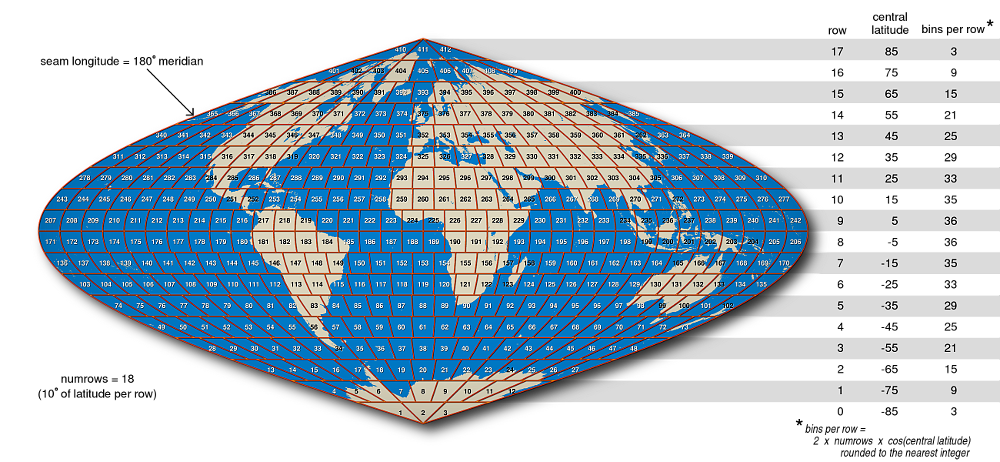

# Integerized Sinusoidal Binning Scheme for Level 3 Data

> This page is an archived copy of NASA OBPG’s documentation
> *Integerized Sinusoidal Binning Scheme for Level 3 Data*
> ([original](https://oceancolor.gsfc.nasa.gov/resources/docs/format/l3bins/)),
> recovered from the [Wayback Machine capture of 6 January
> 2026](https://web.archive.org/web/20260106075308/https://oceancolor.gsfc.nasa.gov/resources/docs/format/l3bins/)
> and reproduced here for reference with attribution. The original is a
> work of the US Government. Figures are the thumbnails from the saved
> page; full-size versions link to the original site. The raw capture
> and the Markdown source live in the package under `inst/l3bins/`.

The level-3 products produced by NASA’s Ocean Biology processing Group
comprise level-2 data that have been spatially and temporally aggregated
after being filtered to exclude unwanted values. Here follows a
description of the spatial aggregation – or binning – method that we
currently use.

## Description

Our level-3 binning scheme is based on the [sinusoidal map
projection](http://en.wikipedia.org/wiki/Sinusoidal_projection). A
modification of that projection is used to divide the Earth into bins of
roughly equal area. The area of the bins is usually chosen based on the
characteristics of the data set that is being binned. (If an orbiting
sensor has an instantaneous field of view that is nearly 100 kilometers
across, then it may not make much sense to group pixels into bins that
are only 5 kilometers across, for example.)

For the purposes of this explanation, let us choose a bin size such that
each bin spans ten degrees of latitude from south to north. The bins of
such a scheme – shown in Figure 1 – are much larger than those we use
for any of the data sets in our archive, but that makes them big enough
to see in a small map of the world, and the basic construction of the
bins is the same as for higher-resolution / smaller-bin arrangements.

  
(full size on the original site:
<https://oceancolor.gsfc.nasa.gov/images/resources/docs/format/l3bins/L3Bins.png>)

Fig. 1  
A sinusoidal map of the Earth centered on the prime meridian with
10-degree bin boundaries and bin numbers superimposed. This bin
resolution is coarser than we use for any of our data sets, but it
serves to illustrate some of the basic features of this binning scheme
which are common to all of the resolutions that we support – namely:

- the alignment of all bins into zonal rows bounded along their north
  and south edges by parallels of latitude,
- the use of the 180-degree meridian as the seam along which all rows
  start and end,
- the choice of an even number of rows such that no row straddles the
  equator,
- the division of each row into an integral number of bins that depends
  on the cosine of the central latitude of that row,
- the monotonic increase in bin number from south to north and from west
  to east in each row, and
- the division of the two polar rows into three bins each.

The above figure shows the sinusoidal nature of our chosen binning
scheme in that the number of bins in each row is reduced by the cosine
of the latitude as one moves north or south of the equator. Where it
differs from a straight sinusoidal projection is in the rounding that
occurs when determining how many bins a given row should be divided
into. This rounding is necessary to avoid fractional bins at the ends of
rows, but it does introduce a small departure from area equality among
bins from different rows. A further small departure from area equality
is introduced by the fact that we assume a spherical Earth instead of
using a more precise ellipsoidal model when we lay out our bin
boundaries.

Figure 2, below, provides a polar view of the layout of level-3 bins.

  
(full size on the original site:
<https://oceancolor.gsfc.nasa.gov/images/resources/docs/format/l3bins/L3Bins.north.png>)

  
(full size on the original site:
<https://oceancolor.gsfc.nasa.gov/images/resources/docs/format/l3bins/L3Bins.south.png>)

Fig. 2  
Polar stereographic maps of the Earth showing 10-degree bin boundaries
and bin numbers around the north and south poles. The antimeridian is
indicated as “seam longitude”.

## Resolutions

The level-3 bin files that we currently distribute come in one of three
resolutions. As hinted at before, the chosen resolution depends somewhat
on the mission. The following table summarizes our level-3 resolutions.

| Approximate Linear Dimension (km) | Approximate Angular Dimension | Average Bin Area (km^2)\* | Number of Latitudinal Rows | Total Number of Bins | Missions Using This Resolution |
|----|----|----|----|----|----|
| 111 | 1 degree | 12,392 | 180 | 41,252 | SAC-D/Aquarius |
| 9.28 | 5 minutes | 86 | 2160 | 5,940,422 | OrbView-2/SeaWiFS ADEOS/OCTS |
| 4.64 | 2.5 minutes | 21.5 | 4320 | 23,761,676 | Nimbus-7/CZCS Terra/MODIS Aqua/MODIS Suomi-NPP/VIIRS Envisat/MERIS |

\*Area computations are based on a spherical Earth having a radius of
6378.145 kilometers.

### 1-Degree (111-kilometer) Bins

One degree (or 111 kilometers) is the bin dimension chosen for the
Aquarius mission. This binning scheme has 180 rows. Figure 3 shows the
size and orientation of these bins over the northwestern Atlantic Ocean.

  
(full size on the original site:
<https://oceancolor.gsfc.nasa.gov/images/resources/docs/format/l3bins/L31degBins.nwAtlantic.png>)

Fig. 3  
Albers conic equal area map of the northwestern Atlantic showing
1-degree bin boundaries and bin numbers as used by the Aquarius mission.

### 9.28-kilometer Bins

We divide the Earth up into 2160 latitudinal rows for the SeaWiFS
mission. For our spherical Earth having a radius of 6378.145 kilometers,
this results in an average bin width of 9.28 kilometers. Figure 4 shows
the size and orientation of these bins over New Zealand’s Cook Strait.

  
(full size on the original site:
<https://oceancolor.gsfc.nasa.gov/images/resources/docs/format/l3bins/L3_9kmbins.CookStrait.png>)

Fig. 4  
Lambert azimuthal equal area map of New Zealand’s Cook Strait showing
9.28-kilometer bin boundaries and bin numbers as used by the SeaWiFS and
ADEOS/OCTS mission.

### 4.64-kilometer Bins

Double the number of latitudinal rows to 4320, and you get the
4.64-kilometer bin size that we use for the MODIS missions. Figure 5
shows the size and orientation of such bins around the Strait of
Messina.

  
(full size on the original site:
<https://oceancolor.gsfc.nasa.gov/images/resources/docs/format/l3bins/L3_4kmbins.StraitOfMessina.png>)

Fig. 5  
Lambert azimuthal equal area map of portions of the Italian regions,
Sicily and Calabria, showing 4.64-kilometer bin boundaries and bin
numbers for selected, highlighted bins as used by the MODIS and other
missions.

Note that computer rounding errors can become significant at higher bin
resolutions (smaller bin sizes). You can get different bin numbers for
the same geographic coordinates if you perform your computations using
32-bit arithmetic and then repeat the computation using 64-bit
arithmetic. 64-bit arithmetic was used in the preparation of the above
figures.

### Bins and Pixels

The binning scheme described on this page is applied to level-2 data;
specifically, the location of the center of each valid level-2 pixel
determines which bin that pixel gets thrown into. Similarly, when it is
time to make an image of the level-3 data, the data from the level-3
bins need to be interpolated into a regular grid of level-3 pixels that
are suitable for display. Figure 6 shows the relationships between these
bins and pixels using a sample MODIS scene of the north coast of
Iceland. (More of the imaged area is available in our [image
gallery](https://oceancolor.gsfc.nasa.gov/gallery/641/).)


MODIS true colour, north coast of Iceland

Overlays (shown interactively on the original page; transparent PNGs
meant to sit on top of the true colour image):

- [Level-2 MODIS pixel
  boundaries](https://hypertidy.github.io/L3bin/articles/images/A2019163141000.Iceland.MODIS_pixel_overlay.png)
- [Level-3 bin
  boundaries](https://hypertidy.github.io/L3bin/articles/images/A2019163141000.Iceland.MODIS_L3b_overlay.png)
- [Level-3 SMI pixel
  boundaries](https://hypertidy.github.io/L3bin/articles/images/A2019163141000.Iceland.MODIS_L3m_overlay.png)
- [Length
  scale](https://hypertidy.github.io/L3bin/articles/images/A2019163141000.Iceland.length_scale.png)

Fig. 6  
Lambert azimuthal equal-area image of Aqua/MODIS data at a nominal
250-meter resolution showing the north coast of Iceland. Selecting
“Level-2 MODIS pixel boundaries” will overlay the nominally 1-kilometer
pixel boundaries on the image. The [bowtie
effect](https://oceancolor.gsfc.nasa.gov/resources/docs/bowtie/modis/)
results in pixel overlap (shown here by using yellow, orange, and black
for sequential scan lines). Selecting “Level-3 bin boundaries” displays
a red overlay of the 4.64-kilometer bin boundaries described in Figure
5. Selecting “Level-3 SMI pixel boundaries” displays the edges of those
pixels in white. At the equator, these standard-mapped-image pixels
would exactly match the corresponding level-3 bins. The closer one gets
to the poles, however, the more SMI pixels there are per bin.

## Sample Code

A set of [Perl](http://www.perl.org/) subroutines are provided below as
an illustration of the steps needed to convert back and forth between
geographic coordinates and level-3 bin numbers. The variable names used
are similar to those given in Appendix A of [NASA Technical Memorandum
104566, Vol.
32](https://oceancolor.gsfc.nasa.gov/resources/docs/technical/seawifs_reports/prelaunch/vol32_abs/).

To use the following subroutines, one would call `initbin` once with the
number of rows in the desired bin resolution. Then one could call
`latlon2bin` or `bin2latlon` as often as needed to convert a
latitude/longitude pair to a bin number or a bin number to a center
latitude/longitude. The `bin2bounds` subroutine will return the bounding
latitudes and longitudes for any given bin number should you wish to
plot bin outlines as in the above figures.

``` perl
my $pi = 4*atan2(1,1);

my ($numrows, @basebin, @latbin, @numbin);

############################################
#                                          #
#    Insert the rest of your code here.    #
#                                          #
############################################

# The following functions are based on the pseudocode found in Appendix A of:
# 
# Campbell, J.W., J.M. Blaisdell, and M. Darzi, 1995:
# Level-3 SeaWiFS Data Products: Spatial and Temporal Binning Algorithms.
# NASA Tech. Memo. 104566, Vol. 32,
# S.B. Hooker, E.R. Firestone, and J.G. Acker, Eds.,
# NASA Goddard Space Flight Center, Greenbelt, Maryland

sub initbin {
  $numrows = shift;

  $basebin[0] = 1;
  for(my $row=0; $row<$numrows; $row++){
    $latbin[$row] = (($row + 0.5)*180.0/$numrows) - 90.0;
    $numbin[$row] = int(2*$numrows*cos($latbin[$row]*$pi/180.0) + 0.5);
    if($row > 0){
      $basebin[$row] = $basebin[$row - 1] + $numbin[$row - 1];
    }
  }
  $totbins = $basebin[$numrows - 1] + $numbin[$numrows - 1] - 1;
}

sub lat2row {
  my $lat = shift;

  my $row = int((90 + $lat)*$numrows/180.0);
  if($row >= $numrows){
    $row = $numrows - 1;
  }
  $row;
}

sub rowlon2bin {
  my ($row,$lon) = @_;

  $lon = constrain_lon($lon);
  my $col = int(($lon + 180.0)*$numbin[$row]/360.0);
  if($col >= $numbin[$row]){
    $col = $numbin[$row] - 1;
  }
  $basebin[$row] + $col;
}

sub latlon2bin {
  my ($lat,$lon) = @_;

  $lat = constrain_lat($lat);
  $lon = constrain_lon($lon);

  my $row = lat2row($lat);
  my $col = int(($lon + 180.0)*$numbin[$row]/360.0);
  if($col >= $numbin[$row]){
    $col = $numbin[$row] - 1;
  }
  $basebin[$row] + $col;
}

sub bin2latlon {
  my $bin = shift;

  my $row = $numrows - 1;
  if($bin < 1){
    $bin = 1;
  }
  while($bin < $basebin[$row]){
    $row--;
  }
  my $clat = $latbin[$row];
  my $clon = 360.0*($bin - $basebin[$row] + 0.5)/$numbin[$row] - 180.0;
  ($clat,$clon);
}

sub bin2bounds {
  my $bin = shift;

  my $row = $numrows - 1;
  if($bin < 1){
    $bin = 1;
  }
  while($bin < $basebin[$row]){
    $row--;
  }
  my $north = $latbin[$row] + 90.0/$numrows;
  my $south = $latbin[$row] - 90.0/$numrows;
  my $lon = 360.0*($bin - $basebin[$row] + 0.5)/$numbin[$row] - 180.0;
  my $west = $lon - 180.0/$numbin[$row];
  my $east = $lon + 180.0/$numbin[$row];
  ($north,$south,$west,$east);
}

sub constrain_lat {
  my $lat = shift;
  $lat =  90 if($lat >  90);
  $lat = -90 if($lat < -90);
  $lat;
}

sub constrain_lon {
  my $lon = shift;
  $lon += 360 while($lon < -180);
  $lon -= 360 while($lon >  180);
  $lon;
}
```
